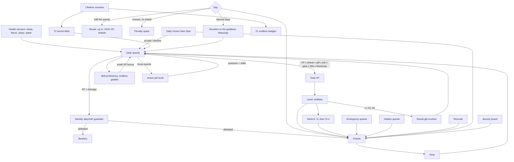

# Life RPG: the System

A game for Home Assistant. Your phone's health sensors become daily quests, and the rest is an RPG built to be played for years:

- XP and levels that never cap, with letter ranks on top (E → S, then S+1, S+2…)
- eight jobs, each with its own level, passives and skills
- skill proficiency that grows with every day you practise
- a racial gift that evolves down the path you train most
- a labyrinth: one floor a week, forever, each guarded by a generated monster
- daily choices from a travelling cast of merchants, spirits and rivals
- emergency, penalty and hidden quests, and a bounty board (with a kids mode for chores)
- loot: chests, six gear slots, six rarities, named uniques, enhancement
- titles, endless badges, and devotion to a goddess whose only believer is you
- **gold and a market**: Marrow Fennick's cart restocks three times a day, and he loves a good haggle
- **painted art** from your own ComfyUI, with the pixel art as the stand-in
- **your LLM in the game**: talk to the goddess, haggle in your own words, get written mornings, side quests, item lore and a weekly chronicle, and play by voice through Assist

Everything lives in a full-screen **System** panel in the sidebar. Each logged-in Home Assistant user sees their own adventurer and can watch the rest of the household's. Matching dashboard cards are included. Setup is all in the UI: no YAML, no helpers to create, nothing to add as a dashboard resource.

## Install

**Needs:** Home Assistant 2026.9 or newer. Optional: [ComfyUI](https://github.com/comfyanonymous/ComfyUI) for paintings, and an LLM integration with an AI Task entity (Ollama, for example) for the goddess's and the merchant's words.

**With HACS:** HACS → ⋮ → **Custom repositories** → add `https://github.com/soullink9/HomeAssistant-Life_RPG` as an **Integration**, then download **Life RPG** and restart Home Assistant.

**By hand:** copy `custom_components/life_rpg` into `/config/custom_components/` and restart Home Assistant.

Then:

1. On each Android phone, enable the Health Connect sensors in **Companion app → Settings → Manage sensors → Health Connect**: daily steps, sleep duration, daily floors and daily hydration.
2. **Settings → Devices & services → Add integration → Life RPG**. Each entry is one adventurer. Pick:
   - **Name:** becomes the entity prefix (`User` gives `sensor.user_level`).
   - **Home Assistant user:** who plays as this adventurer in the System panel.
   - **Race:** chosen for life.
   - **Body:** how your adventurer is drawn (androgynous, feminine or masculine).
   - **Goddess name** (optional): she's called Lune unless you name her.
   - **Sensors and goals.** Leave a sensor empty to skip that quest, or tick it under **Log in Home Assistant**.
3. Open **System** in the sidebar.

Everything else is under the integration's **Configure** menu, and progress is always kept when you change it:

| Page | What's there |
|---|---|
| **Quests and goals** | Sensors, goals, the linked user, clock (12 or 24 hours), water unit (mL or US fl oz), quests you log by hand, and which counts you may correct. |
| **Bounties** | How many daily side quests (0 to 10, 5 by default), and kids mode. |
| **Goddess** | Her name, her personality, and an optional conversation agent to talk through. |
| **Working hours and emergencies** | When you're at work (emergencies there never cost anything), or a schedule, calendar, binary sensor or input boolean that says so. |
| **Art and AI** | Pixel art or paintings, ComfyUI, an optional image-edit model, painting speed, and the AI Task entity for words. |

**After an update** (through HACS, or by copying the folder over), restart Home Assistant. Browsers and the Home Assistant app pick up the new panel by themselves; if a screen was left open, it says so and offers a **Reload** button.

### Phones and missing data
| Quest | Android (Health Connect) | iPhone (Home Assistant app) |
|---|---|---|
| Walk | Daily steps | Steps (pedometer, resets at midnight) |
| Climb | Daily floors* | Floors ascended |
| Rest, Lights out | Sleep duration | Log in Home Assistant |
| Drink water | Daily hydration* | Log in Home Assistant |

\* Samsung Health doesn't share water intake or floors with Health Connect, so those sensors stay empty however the phone is set up. Use **Log in Home Assistant** for those quests, or log water in an app that writes to Health Connect.

**Log in Home Assistant** makes a quest loggable by hand, on its own or on top of a sensor:
- **Panel:** +1 glass / +500 mL (16 fl oz) / Undo on Drink water, +1 flight / +3 / Undo on Climb, and a sleep form (fell asleep, woke up) under the quests.
- **Dashboard card:** + Water and + Stairs on the compact card.
- **Buttons:** `button.<name>_log_a_glass_of_water` and `button.<name>_log_a_flight_of_stairs`, handy for an NFC tag on your water bottle or at the top of the stairs.
- **Actions:** `life_rpg.log` (water or floors; a negative amount undoes), `life_rpg.correct` (today's real count or a record) and `life_rpg.log_sleep` (bedtime and wake, like `22:40` and `06:50`; with only a bedtime it logs just Lights out).
- **Assist:** "I drank a glass of water", "I climbed three flights", "I slept from 11 to 6:30".
- **iPhone and Apple Health:** a Shortcuts personal automation (say, "When my alarm is stopped") with *Find Health Samples*, then the Home Assistant app's *Perform Action* calling `life_rpg.log_sleep` or `life_rpg.log`.

Sleep logged by hand and sleep your phone also reported count once, not twice. Lights out is read from the sleep sensor's session times, its sleep-stage timeline, or the companion app's separate *sleep start* sensor, whichever is there.

### When a sensor gets it wrong
If two apps write the same steps into Health Connect, the total doubles. The game guards against it:
- **Impossible jumps are held back.** Steps can't rise faster than about 260 a minute, floors 4 and water 150 mL, plus an allowance for a phone syncing after time offline. You get a "Reading held back" notice, and the quest shows what was held with a **They were real** button.
- **Each day has a ceiling:** 100,000 steps, 500 floors, 10 litres; and no more than 16 hours of sleep.
- **Fixes upstream are followed.** If the count drops (you removed the duplicate source), the game follows once the lower number has held for 15 minutes.
- **Corrections are off unless you allow them**, per quest, under **Quests and goals → Allow corrections**, so nobody can just type in a number. Turn one on, fix the count (or an inflated record) with **Wrong count?**, then turn it off again.

A steady double count from the start of the day can look human, so set the real count once and fix the source in Health Connect (set the app priority for steps so only one app counts).

## How the systems connect

### Daily quests (reset at midnight)
| Quest | Sensor | Trains | Skill |
|---|---|---|---|
| Walk | Daily steps | Stamina (STA) | Swift Feet |
| Climb | Daily floors (or elevation in m/ft) | Strength (STR) | Mountain Step |
| Rest | Sleep duration (naps add up; counts toward the day you wake) | Vitality (VIT) | Deep Slumber |
| Drink water | Daily hydration | Intelligence (INT) | Water Magic |
| Lights out | When your main sleep started, against your bedtime target | Wisdom (WIS) | Clear Mind |

A quest pays up to 60 XP for progress plus a 40 XP jackpot for finishing. Walk and Climb pay a little more up to 150% of the goal. A day's progress never goes down, whatever the phone does. On the Status tab, **HP** is last night's rest and **MP** is today's water; both stop at 100%.

### Streak, shields and the Penalty Quest
- **Clear the day** by finishing half your quests, rounded up. Each streak day adds +5% XP, up to +50%.
- **Shields:** every 7 streak days earns one (hold 2). A missed day spends a shield instead of the streak.
- **Penalty Quest:** a missed day with no shield opens one. Finish one more quest than usual tomorrow and the streak survives; fail and it ends.

### Emergency quests and daily choices
- **Emergency quests** appear on about 30% of days between 10:00 and 18:30: "A runaway cart is loose in the market. Chase it down: 1,600 steps" in 60 minutes. Clearing one pays XP and a chest.
- **Failing one** during working hours costs nothing (*"Failing penalty: −140 gold… ERR0R. ERROR. Working hours detected."*). Outside them it costs 30 + 2 gold per level, at most 200 and never more than 10% of your gold; declining costs half. If Home Assistant wasn't watching when time ran out, there's no fine.
- **Daily choices** appear each morning (06:00–14:00), from one of 20 characters. Answer Yes or No. A **trade** moves XP from one quest to another for the day; a **bounty** or **timed bounty** pays XP and a chest for finishing a quest; a **contract** asks for N quests; **wagers** stake XP on a perfect day or on beating a goal by 30–50%. Declining is always free.
- **What a chest holds:** every chest holds one item, and an offer shows its odds (a bounty chest: common 25%, uncommon 35%, rare 28%, epic 10%, legendary 2%). When the AI writes what a character says, it's told exactly what the prize is, and a line that oversells it is thrown away.

### The bounty board
On the Quests tab, under the daily quests.
- **Daily side quests:** small, healthy tasks you can do in under 30 minutes ("Stretch for five minutes", "Message a friend"). You get 0 to 10 each morning (5 by default). They're on your honour, and one of them each day holds a bounty chest. Up to three, each pays about 30 XP plus one per level, and some gold; past three, each extra one adds half a side quest's worth to the day, shared out over all of them, so ten side quests pay about twice what three do, not three times. There are over a hundred built-in ones. Your AI writes them if it's set up; the rewards are always the game's. "Lena, I did my stretches" marks one done by voice.
- **Kids mode:** a parent posts chores for a child, each with its own reward (up to 300 XP, up to 300 gold, optionally a bounty chest), once, every day or every week. The child taps **Done**; a parent taps **Approve** (or **Not yet**) before the reward arrives. A parent is any Home Assistant admin, so link the child's own non-admin user to their adventurer. `examples/automations/life_rpg_chore_approval.yaml` sends a phone notification when a chore is waiting.

### Jobs (unlock at level 5)
Pick a job in the **Class** tab. While you hold it, the job earns job XP from your quest XP, with its focus counting double (level = 1 + √(job XP ÷ 150), endless). Job XP starts counting the moment you take the job, so picking one at noon doesn't hand it the morning. Switch jobs and the old one keeps every level and point of XP it earned, ready for when you come back; only the active job's passive and skills count. Each job grows a small passive every level, earns a new title at job levels 10, 20, 35 and 50, and unlocks a skill at 3, 8, 15, 25 and 40.

| Job | Focus | Passive per level | Title path |
|---|---|---|---|
| Ranger | Walk | +0.5% Walk XP | Ranger → Pathfinder → Windrunner → Stormstrider → Sovereign of the Endless Road |
| Warrior | Climb | +0.5% guardian damage | Warrior → Vanguard → Berserker → Warlord → Titan of the Peaks |
| Druid | Rest | +0.5% Rest XP | Druid → Grovekeeper → Archdruid → Verdant Sage → Heart of the World Tree |
| Mage | Water | +1% loot luck | Mage → Tidecaller → Archmage → Archmage of the Deep → Sovereign of Water |
| Monk | Lights out | +0.5% Lights-out XP | Monk → Ascetic → Master of Stillness → Grandmaster → Saint of the Clear Mind |
| Paladin | All five (×1.5) | +1% perfect-day XP | Paladin → Templar → Crusader → Exalted Paladin → Hand of Dawn |
| Rogue | Emergencies, hidden quests | +1% emergency XP | Rogue → Shadowstep → Nightblade → Master Thief → Prince of Whispers |
| Bard | Won daily choices | +1% choice rewards | Bard → Minstrel → Skald → Loremaster → Voice of Legends |

The panel suggests the job your last four weeks point to. **Active bonuses** on the Status tab shows the totals, and **Where they come from, and the limits** lists each source (your race's gift, your job and its level, your title, your gear, skill grades, the goddess's blessings, this floor's trait, today's trade and any potion) and every limit: +50% XP for each quest, +25% XP from every quest, +120% guardian damage, +250% loot luck, and so on. A total that's held at its limit is marked **(max)**, with a line saying what your bonuses add up to. Potions and tonics count on top of the limits.

### Skill proficiency
Every quest has a skill that grows a little each day you practise it, whether or not you finish: Beginner → Intermediate → Advanced → Expert → Master → Grandmaster → Saint, then Saint +1, +2… every 2,000 points. Each grade adds a small XP bonus to its quest.

### The labyrinth
- A new floor opens every Monday. Its guardian is generated: one of 12 creature types × 12 elements, with random traits and a name like "Sugar-Crazed Slime of the Missed Alarm".
- **HP** is your recent daily pace × the days left in the week, so it always asks a little more of you. Every quest's XP is damage.
- **Floor traits** (25) change the week: Flooded Halls doubles water damage, Thin Air boosts Climb XP, Treasure Vault boosts loot luck…
- **Elite floors** every 10th floor and **cursed floors** (about 1 in 10) are tougher and pay double. Lose a week and the next guardian is weaker.
- **Bestiary:** every defeated guardian, plus a tally of creature types (unknown types show as silhouettes).

### Races and racial gifts
Each race has two evolution paths. At level 10 the gift evolves down the path you trained more over the last 28 days, and at level 30 it evolves again.

| Race | Looks | Starting gift | Path A | Path B |
|---|---|---|---|---|
| Human | Average build | Adaptable | Restless Spirit → Unbound Wayfarer | Iron Discipline → Unbreakable Will |
| Elf | Slim, long legs, pointed ears | Moonwell Attunement | Spring Whisperer → Tide Sovereign | Starlit Sage → Eternal Night Oracle |
| Dwarf | Short, broad, four beard styles | Stoneblood | Mountain Breaker → Worldforge Titan | Deep Rest Kin → Hearthstone Elder |
| Beastkin | Fox, cat, wolf, rabbit or bear ears and tails | Wild Pulse | Pack Runner → Alpha of the Endless Hunt | Cliff Stalker → Apex Predator |
| Dragonkin | Scales, slit pupils, horns, wings, tail | Ember Heart | Slumbering Wyrm → Ancient Dragon's Dream | Scaled Ascendant → Draconic Sovereign |

Skin, hair or fur, eye colour, hairstyle and race features are rolled from your adventurer's seed. **Change look** on the Status tab rerolls them, and the Gallery lets you choose them (below).

### Gear and chests
- **Chests** drop for cleared and perfect days, level-ups and rank-ups, records, emergencies, hidden quests, won choices and wagers, bounties and guardians. They wait in the Inventory until you open them.
- **Gear:** six slots and six rarities. Each item has a base type that changes how it looks on your adventurer (Dagger, Staff or Longbow; Hood, Helm or Crown; Robe, Chainmail or Plate; and so on). Rarity changes the materials, with sparkles on legendaries and shifting colour on mythics.
- **Bonuses** are small and capped, so effort stays the main source of XP.
- **Shards:** salvaging an item gives its own shards (1, 3, 8, 20, 50 or 120 by rarity) plus exactly the shards you spent enhancing it, never more, so enhancing and salvaging can't make shards. Enhancing costs more each level, up to +10, and adds 5% to the item's bonuses per level. Selling an enhanced item pays a little more gold but doesn't return the shards, so salvage it if you want them back.

### Titles, badges, devotion
| | |
|---|---|
| **Titles** | 72, all secret: nothing about a title appears until the day you earn it. Equip one for its bonus. |
| **Badges** | 21 lifetime collections: Bronze, Silver, Gold, Platinum, Diamond, then a ★ each time the total doubles. |
| **Hidden quests** | 42 secrets with no hints and no list. One appears only once you've stumbled into it, and pays 250 XP and a chest. |
| **Devotion** | Every cleared day is a day of faith: Believer, Devotee, Apostle, Saint, Hand of the Goddess, then +1 every 250 days, with blessings along the way. |

## Gold and the market
- **Earning gold:** finished quests, cleared and perfect days, records, emergencies, won choices, hidden quests, titles and badges, level-ups, rank-ups, streak milestones, bounties and guardians. Selling spare gear pays a quarter of its price.
- **Deliveries:** Marrow Fennick's cart restocks three times a day: at midnight, sometime between 10:00 and 13:30, and sometime between 16:30 and 20:00 (at least three hours apart, different every day). Each delivery has a theme: his usual mix, a cart of arms and armour, potions and tonics, dyes and finery, or curios and sealed crates. Sundays' first delivery brings a featured epic-or-better piece. A deal you agreed but haven't paid for waits for you through a delivery. Prices grow with your level.
- **Consumables:** XP Elixir (+10% XP today) and Greater Elixir (+20%); a tonic for each quest (+25% XP on that quest today, only for quests you have); Guardian Bane Oil (+25% guardian damage today); Lucky Charm (+100% luck on your next chest); Sealed Crate (a chest with one item, usually common or uncommon); Fate Scroll (swap today's choice); Sand of Hours (+20 minutes on an emergency); Ward Charm (+1 streak shield); Phoenix Feather (restores a streak lost in the last 3 days; rare). Elixirs, oils and tonics are limited to four a week.
- **Cosmetics:** 8 backdrops, 5 poses, 6 dyes and 5 frames. Backdrops, poses and dyes repaint your portrait; frames go around it.

### Haggling
Marrow enjoys a haggle. What he hates is being taken for a fool.
- Every item has a hidden lowest price, 8–18% under list (more if he likes you). **Meet him partway** and you get real back-and-forth: he comes down a little each round, usually over three or four rounds, and the haggling never bothers him. Raising your offer a little each time works best; repeating the same offer wears on him.
- **Lowballs** (well under what he can do) barely move him and annoy him. **Insults** (under half the list price) put that item's price up a little; insult him twice over the same item and he won't haggle over it any more that day.
- **Push him too far** and he stops haggling with you until he has calmed down (an hour or two) or the next delivery arrives. Prices don't go up when he's fed up, and deals you already struck stand.
- **Walk away** mid-haggle and he sometimes calls you back with one better, final price (once per item, more often when he's in a good mood).
- **He remembers you.** Paying fair prices builds rapport, and blowing up at him costs it. Good rapport gives you more room and makes a generous mood likelier; bad rapport the opposite.
- When he won't haggle on an item, it says why: **His last word** (six rounds of haggling done), **Won't haggle: insulted** (until his next delivery) or **Parting offer** (he called you back).
- His face follows the haggling: beaming after a deal, shrewd while you bargain, stubborn at a lowball, annoyed, then red-faced, then furious. Bards haggle further as their job level rises (up to 15%).

In testing, meeting him partway took about four rounds and saved about 10% on average, and never made him fed up; steady lowballs at 62% of list ended the haggling after six or seven offers. With an LLM set up, talk to him in your own words: any price you name is your offer, and "never mind" walks away.

## Art and AI

### Pixel art or paintings
Everything has a pixel-art version drawn in the browser: your adventurer in their gear, every item and guardian, the goddess in each mood, Marrow Fennick, the choice characters, and every potion and cosmetic. Without ComfyUI that's the game's art; with ComfyUI it's the stand-in until a painting is ready.

**Art and AI → Art style:** **Painted** uses ComfyUI, and under **Paint** you can leave categories off (they stay pixel art). **Pixel art only** ignores ComfyUI and any saved paintings. While paintings are on, the panel header has a **Paintings / Pixel art** button so each person can choose on their own device.

### Painting with ComfyUI (local, free)
1. Run ComfyUI somewhere Home Assistant can reach it (for example the `comfyui` Docker image on your GPU machine, port 8188).
2. Pick the matching **Model type** under **Art and AI**:
   - **SDXL:** a fantasy-capable SDXL fine-tune (Juggernaut XL, DreamShaper XL) in `models/checkpoints`. The quick choice.
   - **Flux, all-in-one checkpoint:** a single-file Flux dev checkpoint (for example `flux1-dev-fp8.safetensors`) in `models/checkpoints`.
   - **Flux, separate files:** the model in `models/diffusion_models` (for example `flux1-dev.safetensors`), the text encoders `clip_l` and `t5xxl` in `models/text_encoders`, and `ae.safetensors` in `models/vae`. Pick the model in the Checkpoint list; the rest is found automatically, and the form tells you if something's missing.
   - **Custom:** your own workflow, saved with ComfyUI's *Export (API)* as `/config/life_rpg/workflow.json`, with the placeholders `%PROMPT%`, `%NEGATIVE%`, `%SEED%`, `%WIDTH%`, `%HEIGHT%`, `%OUT_WIDTH%`, `%OUT_HEIGHT%` and `%PREFIX%`. This is how to add LoRAs or upscalers.
3. Enter the ComfyUI address (for example `http://192.168.1.20:8188`), pick the model and choose what gets painted.

What gets painted, most important first: your adventurer, in the gear you actually wear, with your race's features, your job's look, your gift's glow, your rank's aura and any backdrop, pose or dye you own; this week's guardian; the market's current stock (once you open the Market, so deliveries nobody looks at don't keep ComfyUI busy); the goddess in six moods, in the backdrop you chose for her (by default a shrine that grows with your devotion); Marrow Fennick's faces; the twenty choice characters; then your gear and the bestiary. The game's interface (chests, emblems, badges) stays drawn by the game.

### Consistent characters with an image-edit model
Painted from scratch, the same character can look like a different person from one picture to the next. Pick an **Image-edit model** under **Art and AI** to fix that:
- **Flux Kontext** (for example `flux1-kontext-dev.safetensors` in `models/diffusion_models`). It uses the same text encoders and VAE as Flux, found automatically.
- **Qwen Image Edit** (for example `qwen_image_edit_2509_fp8_e4m3fn.safetensors`), which also needs `qwen_2.5_vl_7b` in `models/text_encoders` and `qwen_image_vae` in `models/vae`.

Your adventurer, the goddess and Marrow Fennick then each get one **base painting**: who they are, full body, standing on a plain grey backdrop in plain clothes. It's painted bigger and with more steps than anything else, whatever the painting speed, so the edits have plenty of detail to work from. Every other picture of them is an edit of it: the goddess's moods, outfit and backdrop, Marrow's faces, outfit, accessory and where he trades, your gear, job, pose and backdrop. A new piece of armour edits your portrait instead of repainting you. Your main model still paints everything else (items, guardians, choice characters). If your ComfyUI is missing an edit node, those pictures are painted from scratch instead and the log says why.

Without an edit model, every mood of a character is painted from the prompt, but with the same seed and the same words for who they are (race, age, build, hair, eyes), so they drift much less from picture to picture.

### The Gallery
The **Gallery** tab (while paintings are on) shows every painting, each with its own **Repaint**: ComfyUI paints a new version, the old one stays on screen until it's ready, and then the old file is deleted. With an edit model, each character's base painting comes first; repainting a base redoes every picture of that character from the new one. The tab also shows how many paintings there are, how much space they take and roughly how long the waiting ones will take.

Beside you, the goddess and Marrow are their choices, grouped by what changing them does:

| Group | What's in it | What happens when you change it |
|---|---|---|
| **Shown differently** | Framing | Nothing is repainted. Every painting of them is full body, and the panel crops it (full body, three-quarter, waist up, head and shoulders or close-up), on the Status, Goddess and Market tabs and in the Gallery. |
| **Edited from the base painting** | Outfit, accessory, what you hold, backdrop | The base painting stays, so the face stays. Each picture is edited again. (Without an edit model, each is painted again.) |
| **A new base painting** | Race, age, build, hair, eyes | This is who they are, so a new base painting is made, then every picture is edited from it. |

**You:** age (kid, teen, young adult, adult or elderly), hair or fur colour, hairstyle, eye colour and build (slender to heavyset); what you hold (your equipped weapon, nothing, or a sword, bow, staff, warhammer, spear or dagger); framing. Your race is your adventurer's. Hair, eyes and build change the pixel art too.

**The goddess:** race (human, elf, half-elf, dwarf, fox-eared beastkin, dragonkin or celestial), age, build (petite, slender, average, athletic, sturdy or full-figured), hair colour, hairstyle (eight styles), eye colour; outfit (fourteen, from her moonlit dress to a starlight gown, priestess robes, a huntress's tunic, a festival yukata, scholar's robes, a silver ballgown or a modern hoodie); backdrop (her shrine, which grows with your devotion; **Match each mood**, a different scene for each of her moods, from a calm lantern-lit shrine to storm clouds when she's worried; a night sky, a temple garden, a moonlit lake, a star library, a birch forest or plain grey); framing.

**Marrow Fennick:** race (gnome, halfling, dwarf, human, elf, goblin, raccoon-eared beastkin or dragonkin), age, build (wiry, slight, average, stout, broad-shouldered, heavyset or tall and lanky), hair and beard (eight styles); outfit (eleven, from his patched velvet waistcoat to a sailor's coat, desert robes, a noble's doublet or a tinker's harness), accessory (monocle, spectacles, tinker's goggles, eyepatch, pipe, feathered hat, merchant's scales or nothing), where he trades (his wagon, a market stall, a tavern table, a caravan tent, a cramped shop, a harbour stall or plain grey); framing.

Paintings are kept at 704 × 1024 (base paintings at 768 × 1152), so even a close-up crop stays sharp.

### Painting speed
| Setting | What it does |
|---|---|
| **Quality** | Everything at full size. |
| **Balanced** (default) | Item icons are painted smaller; they're shown small anyway. |
| **Fast** | Also about a third fewer steps, and spare common and uncommon gear stays pixel art. It loads a full-size Flux model at half the video memory, so it can stay loaded beside Ollama instead of reloading for every picture, which is the usual reason paintings crawl on a shared GPU. |

**My model is a fast variant:** tick this for Lightning, Turbo or Hyper SDXL models, or Flux Schnell (4 to 8 steps, a few seconds a picture).

**Sharing the GPU with Ollama:** both want video memory. If paintings wait while your Ollama model is loaded, shorten Ollama's keep-alive so it unloads sooner, or start ComfyUI with `--lowvram`.

**Keeping the folder small:** paintings are saved as WebP in `/config/life_rpg/art/`. A repaint or a new portrait replaces its file. The folder is capped at 1 GB and 1,500 pictures; past that, the least recently shown go first. The built-in workflows use ComfyUI's preview output, so ComfyUI's own `output` folder doesn't fill up. Base paintings sent for editing go to ComfyUI's `input/life_rpg` folder and are overwritten, not added to.

Jobs run one at a time. If ComfyUI is offline the queue waits; if a painting fails, the error shows in the log and that picture is tried again after six hours.

### The goddess
**Configure → Goddess** names her (your voice assistant's name, say) everywhere: panel, titles, blessings, notifications, paintings, conversations and Assist.
- **Personality:** *a playful moon goddess* (built in), or *keep the model's own personality*, where the LLM is told only her name and her role in the game.
- **Talk through this conversation agent:** pick your own assistant (for example your Ollama agent). Her chat replies then come from that agent, in its own voice, with the game's facts sent along with each message. The conversation carries on through the day. Without an agent, the AI Task entity writes her replies. Either way she's told to answer what you actually said, ask things back and not recite your stats.
- **Her gifts:** now and then, while you're talking, she gives you something: a potion or charm, a blessed chest, a purse of gold or, rarely, a cosmetic. The game decides, never the LLM. There's at most one chance a day, and never two gifts within three weeks.

### Your LLM: the goddess, the merchant and the world
Any integration that offers an **AI Task** entity works; with Ollama, add an AI Task under the Ollama integration. Pick it under **Art and AI** (or leave it empty for Home Assistant's default) and choose the features:
- **Talk to the goddess:** a chat in the Goddess tab. Her portrait changes with her mood.
- **Written flavour:** her good-morning message, today's side quests, what the choice's character says, emergency narration, a bestiary entry for each guardian, lore for rare-or-better items, and a weekly chronicle in the Log tab.
- **Haggling:** talk to Marrow Fennick in your own words.

The LLM only writes words. The game decides every number. Without an LLM everything still works: the goddess speaks from 137 built-in lines, and haggling uses an offer box.

### Assist (voice and chat)
The integration adds a **Life RPG** toolset for conversation agents. Turn it on in your agent's options (Ollama → Configure → *Control Home Assistant*: tick **Life RPG** next to **Assist**). Then ask things like:
- "How close am I to clearing today?" or "How's the guardian doing?"
- "Take today's choice." / "Open my chests." / "Sell my junk."
- "What's the merchant selling?" / "Offer him 500 for the staff." / "Walk away from the staff." / "Buy the lucky charm."
- "What's on the bounty board?" / "I fed the dog."
- "Tell Lena I hit my steps before lunch."

Tools act for the adventurer linked to whoever is talking. A voice satellite with no signed-in user acts for the only adventurer, or the one you name.

## Pacing
Roughly, from the three-year simulation in `tests/test_game.py` (hourly sensor updates, every chest opened, best gear worn, job picked at level 5):

| Player | Day 30 | Day 90 | Year 1 | Year 2 | Year 3 |
|---|---|---|---|---|---|
| Casual (~45% of quests) | Lv 8 E | Lv 14 D | Lv 27 C, floor 37 | Lv 38 B | Lv 46 A, floor 102 |
| Steady (~70%) | Lv 11 D | Lv 18 D | Lv 34 B, floor 40 | Lv 47 A | Lv 56 A, floor 108 |
| Grinder (~90%) | Lv 12 D | Lv 21 C | Lv 41 B, floor 40 | Lv 57 A | Lv 69 S, floor 114 |

S rank is a three-year goal for a dedicated player, and the numbers keep going after it. A steady player earns about 41,000 gold in the first year and makes about 135 purchases.

## Screens
**The System panel** has ten tabs (the tab bar wraps onto two rows on a phone):
- **Status:** your adventurer in their gear, level, rank, HP and MP, job, race, attributes, skills, active bonuses and where they come from, today's episode title and the goddess's line.
- **Quests:** the daily choice, the daily quests, emergency and penalty windows with timers, and the bounty board.
- **Labyrinth:** this week's guardian, floor trait, depth, creature tally and bestiary.
- **Inventory:** paper doll with six slots, chests, items, enhance, sell and salvage.
- **Market:** Marrow Fennick, the current stock, haggling, your bag of consumables and your wardrobe.
- **Class:** all eight jobs with their levels, passives and skills, plus skill proficiency.
- **Records:** badges, and the titles and hidden quests you've earned.
- **Goddess:** her portrait, devotion and blessings, a chat with her, and your racial gift tree.
- **Log:** 30-day chart, the weekly chronicle and the System log.
- **Gallery** (while paintings are on): every painting with its Repaint, and the choices for you, the goddess and Marrow.

If several adventurers exist, switch between them at the top; you can only act for your own (admins can act for anyone).

**Cards:** `type: custom:life-rpg-card` with `view: compact | status | quests | labyrinth` and an optional `adventurer: Name`. Tapping a card opens the panel. `examples/dashboard.yaml` has a ready view.

**Phone notifications:** the `examples/automations/` folder has one automation per file: System notifications, an 8 pm "secure your streak" nudge, a Sunday "guardian within reach" push, and chore approvals for kids mode. To add one: **Settings → Automations & scenes → Create automation → Create new automation → ⋮ → Edit in YAML**, replace everything with the file's contents, change `notify.mobile_app_your_phone` and the `user_` prefix, and save.

## Entities (adventurer "User")
`sensor.user_level`, `_level_progress`, `_xp`, `_xp_today`, `_streak`, `_rank`, `_job`, `_title`, `_race`, `_labyrinth` (guardian HP left, %), `_daily_choice`, `_gold` (with your bag and the merchant's mood as attributes), `_chests`, `_emergency_quest`, `_devotion`, one attribute sensor per quest (`_stamina` … with its skill as attributes) and one quest sensor per quest (`_stamina_quest` …). `sensor.user_devotion` carries the goddess's `morning_message` once it's written each day, handy for a daily briefing.

`event.user_achievements` fires every event:
- `level_up`, `rank_up`, `attribute_up`, `skill_up`
- `quest_complete`, `day_cleared`, `perfect_day`, `streak_milestone`, `personal_record`, `reading_held`
- `job_change`, `job_level`, `race_evolved`
- `title_earned`, `badge_earned`, `hidden_quest`
- `emergency_quest`, `emergency_cleared`, `emergency_failed`, `emergency_declined` (with `fine`, `excused` and, for failures, `why`: work, late or off)
- `penalty_quest`, `penalty_cleared`, `streak_broken`, `shield_earned`, `shield_used`
- `guardian_appeared`, `guardian_defeated`
- `choice_offered`, `choice_won`, `choice_lost`
- `bounty_claimed`, `bounty_done`
- `chest_dropped`, `devotion_up`, `bargain_struck`, `market_restocked`, `goddess_gift`

Events that pay gold carry a `gold` attribute.

## Privacy and network use
- Nothing calls out to the internet. The panel, cards and pixel art are served by your own Home Assistant; no fonts, scripts or images load from anywhere else.
- The only outbound connection is to the ComfyUI address you enter (only when it's set and Art style is Painted). Home Assistant sends prompts (and, with an edit model, the character's base painting) and receives the finished pictures, which are checked to be real images under 32 MB.
- Words come from the AI Task entity and conversation agent you pick. With Ollama that stays on your network; with a cloud LLM, your adventurer's progress and your chats go to that provider.
- Only you (or an admin) can act for your adventurer or chat as them. Other household members can watch your progress, but not your conversations.
- Paintings are served at `/life_rpg_art/<hash>.webp` without a login, like `/local`. The names are unguessable hashes.
- Saves stay in `.storage/life_rpg.<entry_id>`, paintings in `/config/life_rpg/art/`.

## Testing
Everything runs with plain Python 3.13; nothing needs a real Home Assistant, ComfyUI or LLM.

| Command | What it checks |
|---|---|
| `python3 tests/test_game.py` | The game's rules, then a three-year simulation of a casual, a steady and a dedicated player (the Pacing table comes from it). |
| `python3 tests/sim_longrun.py` | A 30-year soak with casual, steady, grinder, shopper and chaotic players (breaks of up to two months, missing and junk sensor data, random and invalid actions, a restart every year). It checks for crashes, broken invariants, save size and update speed. `python3 tests/sim_longrun.py 3 1 2` is a quicker 3-year run. |
| `python3 tests/ha/test_integration.py` | The whole Home Assistant side (setup, options, sensors, buttons, actions, the panel's websocket API, Assist tools, the painter and the LLM writer) against stand-ins for Home Assistant, a fake ComfyUI that checks every workflow against ComfyUI's real node signatures, and a fake LLM. Needs `pip install voluptuous pillow`. |
| `python3 tests/ha/soak.py 3 sdxl` | Three years of the Home Assistant side in fast time, with the fake ComfyUI (`sdxl` or `flux_unet`) and LLM: painting and writing budgets, queues, the art folder. |

GitHub Actions runs these on every push (shorter soaks), plus `ruff`, Home Assistant's `hassfest` and the HACS checks. See [CONTRIBUTING.md](CONTRIBUTING.md).

## Files
| Path | What it holds |
|---|---|
| `custom_components/life_rpg/` | The integration. `__init__.py` sets it up and registers the panel; `config_flow.py` the setup and Configure pages; `coordinator.py` reads the sensors and runs one adventurer's game; `sensor.py`, `event.py`, `button.py` the entities; `services.py` the actions; `websocket.py` the panel's API; `llm_api.py` the Assist tools; `lore.py` the LLM's words; `art.py` the ComfyUI painter. |
| `custom_components/life_rpg/engine/` | The whole game in plain Python, with no Home Assistant imports. `game.py` holds the `Game` class (the day loop, scoring, progression, the labyrinth, choices and emergencies), with its other parts in `shop.py` (the market), `board.py` (the bounty board), `inputs.py` (sensors, corrections and hand logging) and `characters.py` (portrait choices, chats and gifts). `rules.py` has the tuning constants and formulas, `content.py` every name, table and line of text, `loot.py` chests and gear, `market.py` gold, stock and haggling, and `appearance.py` looks and painting prompts. |
| `custom_components/life_rpg/frontend/` | The System panel and cards (`life-rpg.js`), their styles (`styles.js`), the pixel-art engine (`art.js`) and the cast (`cast.js`). Plain ES modules, no build step. |
| `custom_components/life_rpg/translations/`, `services.yaml`, `brand/` | UI text, action descriptions and the integration's icon and logo. |
| `examples/` | A dashboard view and four phone-notification automations to copy from. |
| `tests/` | The engine tests and simulations; `tests/ha/` the Home Assistant side. |
| `hacs.json`, `pyproject.toml`, `.github/` | HACS settings, lint settings, and the GitHub checks and issue form. |

## Contributing
Bug reports and pull requests are welcome. [CONTRIBUTING.md](CONTRIBUTING.md) covers how the code is laid out, how to run the checks, and how to release a new version.

## Credits
Code from other people in this project:
- `frontend/art.js`: the seeded random numbers behind the pixel art are adapted from the public-domain `xmur3` hash and `mulberry32` generator, as collected by [bryc](https://github.com/bryc/code/blob/master/jshash/PRNGs.md).
- `art.py`: the built-in ComfyUI workflows (SDXL, Flux, Flux Kontext and Qwen Image Edit) follow the node layouts of [ComfyUI's example workflows](https://comfyanonymous.github.io/ComfyUI_examples/).

Everything else was written for this project, with help from Claude, Anthropic's AI model.

## License
[GNU General Public License v3.0](LICENSE). You may use, study, share and change Life RPG; if you share a changed version, share its source under the same licence.
